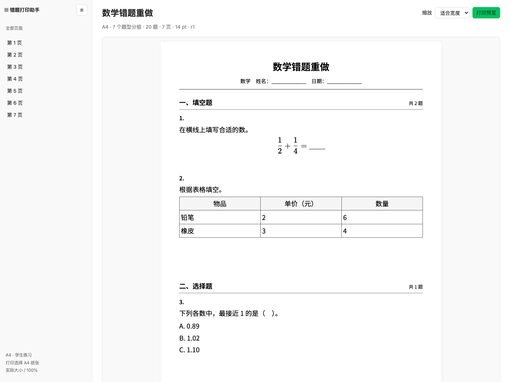
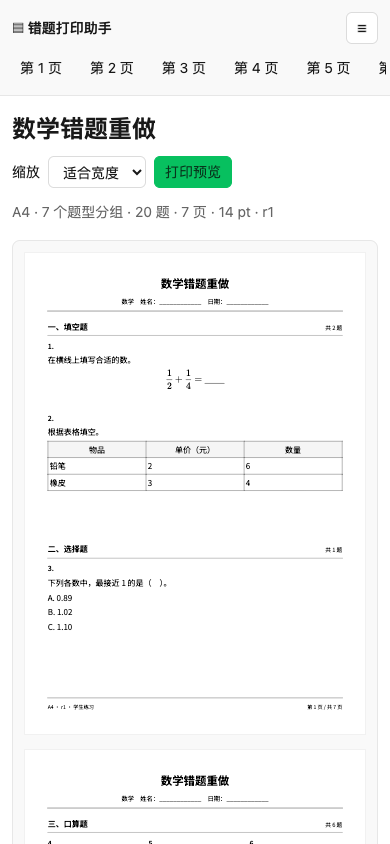

# Mistake Workbook

**English** | [简体中文](README.zh-CN.md)

[](package.json)
[](https://github.com/cabbage2000-lab/mistake-workbook/actions/workflows/ci.yml)
[](LICENSE)
[](#requirements)
[](#installation)
[](#installation)
[](#installation)

Turn math, Chinese, and English questions into printable A3/A4 practice worksheets. Works with **WorkBuddy, Codex, and Claude Code**.

<table>
  <tr>
    <th width="76%">Desktop preview</th>
    <th width="24%">Mobile preview</th>
  </tr>
  <tr>
    <td valign="top"><a href="doc/evidence/grouped-exam-desktop.png"></a></td>
    <td valign="top"><a href="doc/evidence/grouped-exam-mobile.png"></a></td>
  </tr>
</table>

Synthetic sample questions, shown in the Chinese worksheet interface. Click either image to view it at full size. [Sample details and PDF checks](#samples-and-printing)

This standalone AI skill produces offline HTML, page thumbnails, student PDFs, and optional separate answer booklets. The AI host reads text or photos and handles corrections through conversation; local TypeScript scripts validate, save, paginate, and export the content. All three hosts use the same `SKILL.md` and supporting files. No project account, persistent service, database, or other skill is required.

The worksheet interface, skill instructions, and reference documents are currently in Chinese. This repository provides English and Chinese READMEs.

**Quick links:** [Installation](#installation) · [CLI quick start](#cli-quick-start) · [Skill instructions](SKILL.md) · [Task protocol](references/protocol.md) · [Acceptance records](doc/acceptance.md) · [GitHub publishing](doc/github-release.md) · [Product requirements](doc/PRD.md)

## Features and scope

| Capability | Details |
| --- | --- |
| Three subjects | Math arithmetic, column calculations, expressions, and word problems; Chinese pinyin, copying, dictation, and reading; English bidirectional dictation and reading; shared choice, true/false, and fill-in questions |
| Exam structure | Group questions by subject and type, with section headings and continuous question numbering shared by the student worksheet and answer booklet |
| Original content | Preserve text, formulas, options, diagrams, tables, reading subquestions, source locations, and original question numbers |
| Print layout | A3/A4 portrait; standard, compact, or spacious presets; automatic or 1–3 columns; writing space measured in millimeters; ruled lines, four-line guides, and character grids |
| Review and editing | Resolve specific uncertainties, include or exclude questions, reorder, merge, split, and protect manual edits during re-identification |
| Preview and export | Offline HTML, PNG previews of every page, student PDFs, and optional separate answer booklets |
| Recovery | Saved tasks, revision snapshots, generation reports, stale-result detection, and retries without re-entering questions |

Inputs are text and JPEG, PNG, or WebP images. The host must convert PDF/Word documents to text or images first. The scripts do not perform OCR, automatically identify wrong answers, provide an online question bank, or invent missing problem details. The validated scope is up to 10 images per batch and 100 selected questions; split larger inputs into batches.

## Installation

### Requirements

- **Node.js ≥22.6** and npm.
- Chromium or Chrome for pagination, screenshots, and PDF generation.
- For the conversational workflow, an AI host that can read text/images, write files, and execute local scripts. Running the structured example directly does not require an AI host.

### Install in WorkBuddy, Codex, or Claude Code

From source, run `npm ci`, then choose a distribution:

| Distribution | Build command | ZIP to use |
| --- | --- | --- |
| WorkBuddy Open Platform (under 3 MB) | `npm run package:workbuddy` | `dist/mistake-workbook-workbuddy.zip` |
| Full package with the Chinese font | `npm run package` | `dist/mistake-workbook.zip` |

Upload **`mistake-workbook-workbuddy.zip`** to the WorkBuddy Open Platform. It omits the large Chinese font and adds the required bilingual marketplace metadata; the build fails if the ZIP reaches 3,000,000 bytes. On first use, `npm run setup:font` downloads the same complete font from a pinned GitHub commit and verifies its SHA-256. This requires network access once; subsequent runs use the local font. The full package includes the font and works with all three hosts. Keep the complete extracted folder, including `scripts/`, `assets/`, `references/`, and the dependency manifests. See the [WorkBuddy Open Platform format](https://open.workbuddy.cn/docs/skill).

| Host | Installation / final location | Invocation |
| --- | --- | --- |
| WorkBuddy | Import the ZIP through the skills page: “专家·技能·连接器 → 技能 → 添加技能 → 上传技能”. For a local project, use `<project>/.codebuddy/skills/mistake-workbook/` | Ask explicitly to use `mistake-workbook` |
| Codex | User: `~/.agents/skills/mistake-workbook/`; project: `<project>/.agents/skills/mistake-workbook/` | In CLI / IDE, mention `$mistake-workbook` or select it through `/skills` |
| Claude Code | User: `~/.claude/skills/mistake-workbook/`; project: `<project>/.claude/skills/mistake-workbook/` | Use `/mistake-workbook` followed by your request |

These locations and invocation methods follow the official documentation: [WorkBuddy skill import](https://www.codebuddy.cn/docs/workbuddy/From-Beginner-to-Expert-Guide/Function-Description/Skills-Market), [WorkBuddy project configuration](https://www.codebuddy.cn/docs/workbuddy/From-Beginner-to-Expert-Guide/Function-Description/Project), [Codex Skills](https://developers.openai.com/codex/skills), and [Claude Code Skills](https://code.claude.com/docs/en/skills). Directory installation assumes a session with local file access and script execution.

For manual installation, run the following from this project root and select one destination for your host (Bash/zsh):

```sh
# Codex: user-level installation
workbook_skills_dir="$HOME/.agents/skills"

# Claude Code: use this line instead
# workbook_skills_dir="$HOME/.claude/skills"

# WorkBuddy: replace this with your local project path
# workbook_skills_dir="/path/to/project/.codebuddy/skills"

mkdir -p "$workbook_skills_dir"
unzip dist/mistake-workbook.zip -d "$workbook_skills_dir"
cd "$workbook_skills_dir/mistake-workbook"
```

The result should be `<skills-directory>/mistake-workbook/SKILL.md`, without an extra nested `mistake-workbook/` folder. After a WorkBuddy upload, ask the host to locate the installed `SKILL.md` and prepare dependencies in that directory. `agents/openai.yaml` contains optional Codex display metadata; the shared workflow lives in `SKILL.md`.

You can also use the source folder directly by asking any supported host to read [SKILL.md](SKILL.md). Installation, skill discovery, and real image input have not yet been tested separately in all three clients. The shared local preview, PDF export, editing, and recovery workflows have been verified.

### Prepare runtime dependencies

Run in the project root or the extracted `mistake-workbook/` directory:

```sh
npm ci
npm run setup:font
npx playwright install chromium
```

Initial dependency and browser installation requires network access. The full package includes the Chinese font; the WorkBuddy package downloads it during setup. `setup:font` verifies an existing font without downloading it again. If GitHub is unavailable, copy `assets/fonts/NotoSansSC.woff2` from the full package, then rerun setup. Font licenses are included in both packages, and formula fonts come with dependencies. Generated HTML and PDFs embed their fonts and can be read offline.

When a proxy environment variable such as `HTTPS_PROXY` or `https_proxy` is set, font setup uses system `curl` to honor it; otherwise it uses Node's built-in downloader.

Browser selection uses `MISTAKE_WORKBOOK_CHROME` first, then Playwright's bundled Chromium, then recognized system Chrome/Chromium paths. To use an existing browser, set its executable path, for example on macOS:

```sh
export MISTAKE_WORKBOOK_CHROME="/Applications/Google Chrome.app/Contents/MacOS/Google Chrome"
```

`doctor` checks directory write access, the installed Chinese font, and browser PDF support, and reports Node and browser versions. Verify the host's image-reading capability with an actual attachment.

## Use through conversation

After installation and activation, provide question text or photos with your request. If using the source folder directly, first ask the host to read [SKILL.md](SKILL.md).

| Host | Example request |
| --- | --- |
| WorkBuddy | `Use mistake-workbook to turn the questions in these photos into an A4 practice worksheet and export a student PDF.` |
| Codex CLI / IDE | `$mistake-workbook Organize these questions into an A4 worksheet and export a student PDF with a separate answer booklet.` |
| Claude Code | `/mistake-workbook Create an A3 worksheet from these questions, leave generous writing space, and export a PDF.` |

Continue with natural-language changes in any host:

> Group these questions by type, leave blank writing space for math, and export an A4 student PDF.

> Create an A3 version from the same questions with more writing space and a separate answer booklet.

> Resume the previous task, exclude question 3 for now, add two writing lines to question 5, and export again.

The host receives materials, organizes questions, resolves uncertainties, selects a layout, previews, and exports. Parents specify which questions to include and answer concrete clarification questions; they do not need to edit JSON or run commands. When export is already requested and no uncertainties remain, preview and PDF generation can proceed together.

## CLI quick start

These Bash/zsh commands run from the project root. [examples/task.json](examples/task.json) contains six confirmed math questions for a complete example. Use a separate task directory to keep personal worksheets apart from the retained samples in `output/`.

```sh
workbook_task_dir="$HOME/mistake-workbook-tasks/demo"

# Check the environment; creates the directory but not a question task
npm run workbook -- doctor --task "$workbook_task_dir"

# Import, validate, preview, and export a student PDF and answer booklet
npm run workbook -- init --task "$workbook_task_dir" --input examples/task.json
npm run workbook -- validate --task "$workbook_task_dir"
npm run workbook -- preview --task "$workbook_task_dir"
npm run workbook -- export --task "$workbook_task_dir" --answers

# Read the saved task and current output paths
npm run workbook -- status --task "$workbook_task_dir"
```

Commands return JSON reports. After export, use `student.html`, `student.pdf`, and `answers.pdf`; in a `status` response, these fields are under `latest`. Filenames in `student.thumbnails` are relative to the report's `directory`.

Omit `--answers` for a student worksheet only. `export` also generates HTML and every page PNG, so a separate `preview` step is optional. `generate` is an alias for `export`. To continue an existing task, use `status` or `apply`; a new `init` requires a different directory.

### Command reference

Use `npm run workbook -- <command> --task <task-directory> [options]`. Show complete help with `npm run workbook -- --help`.

| Command | Common options | Purpose |
| --- | --- | --- |
| `doctor` | None | Check write access, fonts, browser, and PDF support |
| `init` | `--input <task.json>`, or `--title <title> --request <request>`; optional `--paper A3` / `--paper A4` | Create a task; a title-only task still needs sources and questions |
| `import-image` | `--file <image> --id S1`; optional `--rotate 90`, `--crop x,y,w,h` | Save the original and working copy; does not recognize or create questions |
| `status` | None | Read revision, source coverage, sections, uncertainties, and current artifacts |
| `apply` | `--input <patch.json>` | Atomically apply changes with `expectedRevision` |
| `validate` | None | Check structure, export requirements, and required images; list blockers in `problems` |
| `preview` | Optional `--draft` | Generate HTML and page PNGs; unresolved content requires a marked draft |
| `export` / `generate` | Optional `--answers` | Generate a student PDF and, if requested, an answer booklet with matching previews |

For `validate`, `valid:true` means structural parsing succeeded; check `exportable` to determine whether export is allowed. Blockers produce exit code `2`. Other execution errors use exit code `1` and write JSON to stderr. Draft mode cannot generate a final PDF or answer booklet.

## Layout and editing

Explicit A3/A4 choices take priority. When no paper size is provided, a new request containing the Chinese word `试卷` defaults to A3; other requests default to A4. Defaults are portrait orientation, 14pt text, 14mm margins, the standard preset, and automatic columns. Text size is limited to 12–20pt. The layout reduces columns or adds pages while preserving the chosen text size and physical writing space.

Questions are grouped by subject and type, retaining relative order within a group. Chinese-to-English and English-to-Chinese dictation form separate groups. Section headings stay with the first question and repeat with a continuation marker across pages; reading passages stay associated with their subquestions. Use `status.sections` to map printed question numbers to stable IDs before editing. See the [subject templates](references/subjects.md) for ordering and spacing rules.

Math writing areas are blank by default. English handwriting can use four-line guides, while English-to-Chinese answers use ordinary ruled lines. Choice, true/false, and fill-in questions with enough inline answer space can use `workspace.mm:0`. Four-line guides use complete 18mm groups and are not compressed to fit a page limit.

### Example: switch to a spacious A3 layout

Continue from the CLI example and check the current `revision` with `status`. The `expectedRevision:1` below applies only to the unmodified example task; use the actual revision for an existing task.

```sh
cat > "$workbook_task_dir/layout-patch.json" <<'JSON'
{
  "expectedRevision": 1,
  "operations": [
    {
      "op": "layout",
      "changes": {
        "paperSize": "A3",
        "paperReason": "explicit",
        "preset": "spacious"
      }
    }
  ]
}
JSON

npm run workbook -- apply --task "$workbook_task_dir" --input "$workbook_task_dir/layout-patch.json"
npm run workbook -- export --task "$workbook_task_dir" --answers
```

A successful edit increments the revision. Export measures and paginates the updated content again. `--paper` applies only to `init`; change existing tasks through `apply`. To keep current A3 and A4 versions side by side, create two task directories from the same input. Previous exports remain in their own directories.

Changes to question content, merging, splitting, or re-identification require renewed confirmation. Layout-only changes preserve content confirmation. See the [task protocol](references/protocol.md) for fields and operations, and [scripts/schema.ts](scripts/schema.ts) for the strict schema.

## Saving and recovery

Each task is stored independently. Files are created as needed:

```text
<task-directory>/
├── task.json                  # Current task
├── revisions/r0001.json       # Full snapshot for each revision
├── resources/                 # Original images, working copies, and diagrams
├── generation.json            # Most recent generation attempt
├── latest.json                # Most recent success matching the task when generated
└── exports/r0001-<id>/         # Separate directory for each generation
    ├── <title>-<paper>-<date>-r1-学生卷.html
    ├── <title>-<paper>-<date>-r1-学生卷.pdf
    ├── <title>-<paper>-<date>-r1-答案册.html / .pdf
    ├── student-page-001.png
    ├── answers-page-001.png
    └── report.json
```

`学生卷` denotes the student worksheet and `答案册` the answer booklet. PDFs are created only during export; answer artifacts are created only when requested. Reports include revision, question-to-page mapping, page count, paper size, text size, browser version, duration, excluded questions, and blockers.

Run `status` with the saved task directory to resume in a new conversation. `latest.stale:true` means the existing files reflect an older task state and need regeneration. `latest.latestAttempt` describes the most recent running or failed attempt. Fix the cause and rerun `export` without re-uploading saved questions.

Closing a conversation does not delete local materials. Back up or move the entire task directory; regenerate after moving to refresh absolute paths in reports. Student output excludes reference answers, dictation targets, and source transcripts. Unverified answers are marked “未提供” (not provided) in the answer booklet. Images containing previous answers require explicit confirmation to retain them and receive a visible label.

## Samples and printing

[Desktop preview](doc/evidence/grouped-exam-desktop.png) · [Mobile preview](doc/evidence/grouped-exam-mobile.png) · [PDF checks](doc/evidence/grouped-exam-pdf-checks.json)

The development workspace retains one sample batch in `output/exam-by-type/`: six sets of 20 questions. If generated locally, open `output/exam-by-type/index.html` for student PDFs, answer booklets, HTML, and page PNGs. `manifest.json` in the same directory lists the generated files. Complete generated worksheets are not committed to the repository.

| Subject | Questions per set | A4 student pages | A3 student pages |
| --- | --- | --- | --- |
| Math | 20 | 7 | 4 |
| Chinese | 20 | 8 | 5 |
| English | 20 | 3 | 2 |

These counts describe the retained question-grouping samples from November 9, 2026. Actual pagination varies with content, layout, and dependency versions. Print the generated PDF on matching A3/A4 paper at **actual size / 100%**.

`output/` is ignored by Git and excluded from the installation ZIP. To recreate the complete samples in a fresh checkout or installation, select a new directory without existing tasks:

```sh
npm run samples -- "$HOME/mistake-workbook-tasks/samples-new"
```

This generates HTML, PDFs, page PNGs, `manifest.json`, and `index.html` for all six sets. The retained `pdf-checks.json` and `*-pdf-contact.png` files were produced separately during acceptance checks, not by `samples`. Old directories are not automatically cleaned up. Keep the latest sample batch in `output/` and store real practice tasks separately.

## Testing and packaging

```sh
npm run typecheck          # TypeScript checks
npm test                   # Data, state, and revision tests
npm run test:integration   # Browser, pagination, interaction, and PDF tests
# Or run npm run test:all to execute all three in sequence

npm run package            # Create the ZIP and its .sha256 checksum
npm run package:workbuddy  # Create the upload ZIP, strictly under 3 MB
npm run test:install       # Verify the new ZIP in an isolated directory
npm run test:install -- --workbuddy  # Test font download and the lightweight ZIP
```

Unit/state tests cover sources, confirmation, merging and splitting, section numbering, answer projection, concurrent revisions, and recovery. Browser tests cover A3/A4 PDFs, question completeness, physical dimensions, continuation pages, mobile/desktop interaction, missing assets, page limits, and stale results.

`test:integration` and `test:install` need a working browser. `test:install` also needs `unzip` and installs dependencies offline from the official npm registry's cache. Before the first run, use `npm ci --registry=https://registry.npmjs.org` to populate that cache. The `--workbuddy` test additionally needs network access to download the pinned font. Both tests extract and save `install-smoke.json` in a temporary directory, and print the report to the terminal. Build the corresponding package before installation testing so the archive matches the source.

Both distributions include the READMEs, skill instructions, source code, font licenses, examples, tests, and acceptance documentation. The full distribution also includes the Chinese font. Both exclude `node_modules/` and `output/`. Users still need to prepare dependencies, the font, and a browser as described above.

GitHub Actions checks dependencies, types, unit/browser tests, both packages, and isolated installations on Node.js 22 and 24. It retains both ZIPs and checksums as build artifacts; check the CI badge for the latest remote result. See [GitHub publishing preparation](doc/github-release.md). `private:true` in `package.json` prevents accidental npm publication and does not affect a public GitHub repository or ZIP distribution.

Historical results and evidence are in the [acceptance records](doc/acceptance.md). Samples contain original synthetic material, not real student information. Paper printing, parent completion times, and real attachment transcription accuracy still require manual validation.

## Troubleshooting

| Symptom | What to do |
| --- | --- |
| WorkBuddy rejects the ZIP because it exceeds 3 MB | Run `npm run package:workbuddy` and upload `dist/mistake-workbook-workbuddy.zip` |
| Host cannot find the skill | Check the installation location and `mistake-workbook/SKILL.md` nesting. Confirm the skill is enabled in WorkBuddy or visible in the Codex / Claude Code skill or command list; reopen the session if needed |
| Browser fails to launch | Run `npx playwright install chromium`, or check the executable in `MISTAKE_WORKBOOK_CHROME`, then run `doctor` |
| Task directory already exists | Resume with `status`, edit with `apply`, or choose a different directory for a new task |
| Final export is blocked | Run `validate` and resolve `problems`, including source scope, pending questions, uncertainties, and images. Use `preview --draft` to inspect unresolved content |
| Revision conflict or `stale:true` | Read `status`, merge against the current revision, and export again |
| Missing image, missing font, or font validation failure | Restore task images; for a missing font, run `npm run setup:font`. Restore a damaged font from the full package. Images must use paths relative to the task directory. Retry export |
| Content does not fit or exceeds the page limit | Split long content at logical boundaries; adjust columns, paper size, or the page limit while preserving readable text and adequate writing space |
| Another operation is writing the task | Wait for it to finish. After an unexpected exit, verify no writing/generation process remains before handling `.task.lock` |
| Offline installation cache miss | Run `npm ci --registry=https://registry.npmjs.org` online, then retry `npm run test:install` |

## Project structure

```text
mistake-workbook/
├── README.md                 # English overview and usage (default)
├── README.zh-CN.md           # Chinese overview and usage
├── SKILL.md                  # Shared skill entry point
├── LICENSE
├── package.json / package-lock.json / tsconfig.json
├── .github/workflows/        # GitHub CI
├── agents/                   # Optional Codex display metadata
├── assets/
│   ├── worksheet.ts          # Browser layout template
│   ├── print.css             # Print and preview styles
│   └── fonts/                # Chinese font and OFL license
├── doc/                      # Project documentation
│   ├── PRD.md
│   ├── acceptance.md
│   ├── github-release.md
│   ├── THIRD_PARTY_NOTICES.md
│   └── evidence/             # Screenshots, logs, and check results
├── references/               # Protocol, subject, and delivery rules for the host
├── scripts/                  # CLI, generation, validation, samples, and packaging
├── examples/                 # Runnable task example
└── tests/                    # Automated tests and fixtures
```

Project documentation lives in `doc/`; operational reference material uses the skill convention `references/`. Templates sit directly in `assets/`. Local `node_modules/`, `output/`, and `dist/` directories are ignored by Git; `output/` retains the latest sample batch.

## License

Released under the [MIT License](LICENSE). Font, reused code, and dependency attribution is documented in [third-party notices](doc/THIRD_PARTY_NOTICES.md). Exact dependency versions are recorded in [package-lock.json](package-lock.json).
