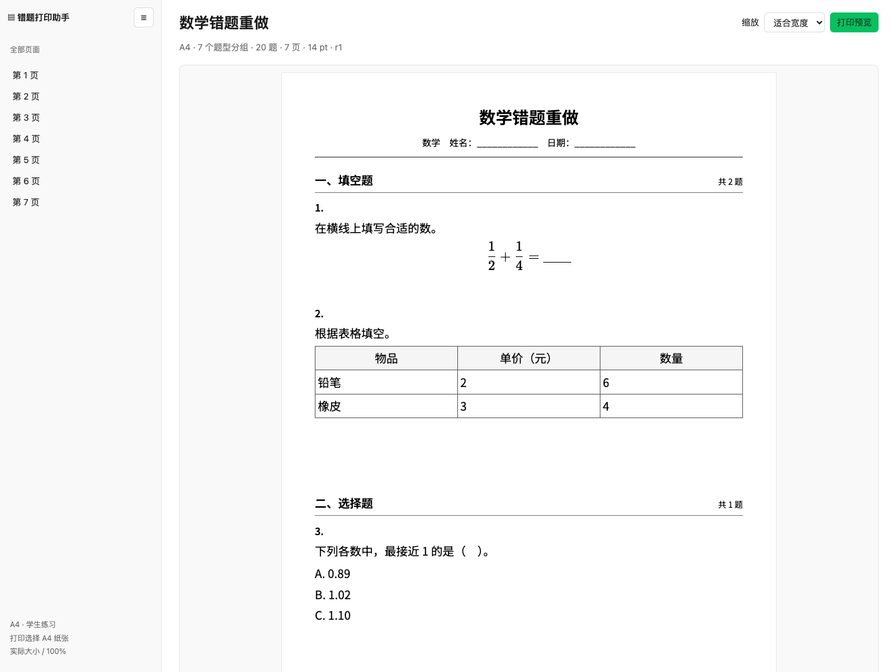
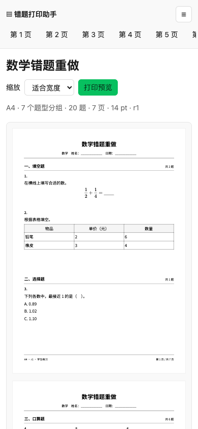

# 错题打印助手

[English](README.md) | **简体中文**

[](package.json)
[](https://github.com/cabbage2000-lab/mistake-workbook/actions/workflows/ci.yml)
[](LICENSE)
[](#环境要求)
[](#安装)
[](#安装)
[](#安装)

将数学、语文、英语错题整理为可打印的 A3/A4 练习，支持 **WorkBuddy、Codex、Claude Code**。

<table>
  <tr>
    <th width="76%">桌面预览</th>
    <th width="24%">手机预览</th>
  </tr>
  <tr>
    <td valign="top"><a href="doc/evidence/grouped-exam-desktop.png"></a></td>
    <td valign="top"><a href="doc/evidence/grouped-exam-mobile.png"></a></td>
  </tr>
</table>

截图使用原创合成题目，点击图片可查看原图。[样张详情与 PDF 检查](#样张与预览)

生成结果包含离线 HTML、逐页预览图、学生 PDF 和可选独立答案册。

本项目是可独立安装的 AI 技能（skill），支持 **WorkBuddy、Codex、Claude Code**。三者共用同一套 `SKILL.md`、参考文档与本地脚本，无需维护三个版本。宿主 AI 负责读取文字或照片、整理题意与对话修改；本地 TypeScript 脚本负责校验、保存、排版和导出。无需项目账号、常驻服务或数据库，运行时不依赖其他 skill。

**快速入口：** [样张与预览](#样张与预览) · [宿主使用指引](SKILL.md) · [任务协议](references/protocol.md) · [验收记录](doc/acceptance.md) · [GitHub 发布准备](doc/github-release.md) · [产品需求](doc/PRD.md)

## 功能与适用范围

| 能力 | 说明 |
| --- | --- |
| 三科练习 | 数学口算、竖式、脱式、应用题；语文拼音、抄写、默写、阅读；英语双向默写、阅读；三科选择、判断、填空等 |
| 试卷结构 | 按学科、题型归组，生成大题标题，小题全卷连续编号；学生卷与答案册编号一致 |
| 题面保留 | 支持文字、公式、选项、题图、表格与阅读子题，记录来源位置和原题号 |
| 可打印布局 | A3/A4 纵向，标准、紧凑、宽松方案，自动或 1–3 栏，逐题毫米留白、横线、四线格与字格 |
| 校对与修改 | 疑点逐项确认，选题与排除，排序、合并、拆分，重新识别时保护人工修改 |
| 预览与导出 | 离线 HTML、全部页面 PNG、学生 PDF；按需生成独立答案册 |
| 保存与恢复 | 任务落盘、修订快照、生成报告、旧结果标记，失败后可从原任务重试 |

输入支持文字和 JPEG、PNG、WebP 图片；PDF/Word 需要先由宿主转成文字或图片。脚本不提供 OCR、自动判错或在线题库，也不自动补全缺失题意。每批图片最多 10 张为已验证范围，入选题目最多 100 题，超出需分批处理。

## 安装

### 环境要求

- Node.js **≥22.6** 和 npm。
- Chromium 或 Chrome，用于实际分页、截图与 PDF 导出。
- 使用对话流程时，宿主 AI 须能读取文字/图片、写入文件并执行本地脚本；仅运行结构化示例不需要 AI 宿主。

### 安装到 WorkBuddy、Codex 或 Claude Code

从源码先运行 `npm ci`，再运行 `npm run package` 得到 `dist/mistake-workbook.zip`。也可使用已有安装包；三种宿主使用同一份完整包，保留其中的 `scripts/`、`assets/`、`references/` 和依赖清单。

| 宿主 | 安装方式 / 最终目录 | 对话调用 |
| --- | --- | --- |
| WorkBuddy | 在“专家·技能·连接器 → 技能 → 添加技能 → 上传技能”导入 ZIP；本地项目也可放到 `<项目>/.codebuddy/skills/mistake-workbook/` | 明确提出“使用 mistake-workbook 错题打印助手……” |
| Codex | 用户级 `~/.agents/skills/mistake-workbook/`；项目级 `<项目>/.agents/skills/mistake-workbook/` | CLI / IDE 中使用 `$mistake-workbook`，或通过 `/skills` 选择 |
| Claude Code | 用户级 `~/.claude/skills/mistake-workbook/`；项目级 `<项目>/.claude/skills/mistake-workbook/` | 使用 `/mistake-workbook`，后接整理与导出要求 |

安装位置与调用方式依据官方文档：[WorkBuddy 技能导入](https://www.codebuddy.cn/docs/workbuddy/From-Beginner-to-Expert-Guide/Function-Description/Skills-Market)、[WorkBuddy 项目配置](https://www.codebuddy.cn/docs/workbuddy/From-Beginner-to-Expert-Guide/Function-Description/Project)、[Codex Skills](https://developers.openai.com/codex/skills)、[Claude Code Skills](https://code.claude.com/docs/en/skills)。这里的目录安装面向能够访问本地文件和执行脚本的会话。

手动安装时，在本项目根目录执行以下命令，按所用宿主选择一个目标目录（Bash/zsh）：

```sh
# Codex：用户级安装
workbook_skills_dir="$HOME/.agents/skills"

# Claude Code：改用下面这一行
# workbook_skills_dir="$HOME/.claude/skills"

# WorkBuddy：项目级安装，将路径替换为实际项目路径
# workbook_skills_dir="/path/to/project/.codebuddy/skills"

mkdir -p "$workbook_skills_dir"
unzip dist/mistake-workbook.zip -d "$workbook_skills_dir"
cd "$workbook_skills_dir/mistake-workbook"
```

解压后应直接存在 `<技能目录>/mistake-workbook/SKILL.md`，避免多嵌套一层同名目录。使用 WorkBuddy 上传入口时，可让宿主定位已安装技能的 `SKILL.md`，再在它所在目录准备下面的运行依赖。`agents/openai.yaml` 是 Codex 的可选展示配置，共用工作流写在 `SKILL.md` 中。

也可以不安装，直接在项目中让任一宿主读取根目录 [SKILL.md](SKILL.md) 后执行。三个客户端的安装、技能发现与真实附件读图尚未逐一实测；已验证的是共用脚本的预览、PDF 导出、修改与恢复流程。

### 准备运行依赖

在项目根目录或解压后的 `mistake-workbook/` 目录执行：

```sh
npm ci
npx playwright install chromium
```

首次安装依赖与浏览器需要网络。中文字体、公式字体和许可随包或依赖提供，生成的 HTML/PDF 可离线查看。

浏览器选择顺序为：`MISTAKE_WORKBOOK_CHROME` 指定的可执行文件 → Playwright 自带 Chromium → 脚本识别的系统 Chrome/Chromium 路径。已有浏览器时，可按实际路径设置，例如 macOS：

```sh
export MISTAKE_WORKBOOK_CHROME="/Applications/Google Chrome.app/Contents/MacOS/Google Chrome"
```

`doctor` 会检查目录写入、随包中文字体和浏览器 PDF 能力，并报告 Node 与浏览器版本；宿主是否能读图需通过实际附件验证。

## 通过对话使用

安装并启用技能后，在对应宿主中发起请求并提供题目文字或照片；未安装时先让宿主读取 [SKILL.md](SKILL.md)。显式调用示例：

| 宿主 | 示例请求 |
| --- | --- |
| WorkBuddy | `使用 mistake-workbook 错题打印助手，把这些照片里的错题整理为 A4 练习并导出学生 PDF。` |
| Codex CLI / IDE | `$mistake-workbook 把这些错题整理为 A4 练习，导出学生 PDF 和独立答案册。` |
| Claude Code | `/mistake-workbook 把这些错题整理为 A3 试卷，保留充足书写空间并导出 PDF。` |

进入工作流后，三种宿主都可用自然语言继续修改，例如：

> 把这些错题整理为 A4 练习，按题型分组，数学题保留空白作答区，导出学生 PDF。

> 用同一批题再生成 A3 试卷，书写空间宽松一些，并附上独立答案册。

> 继续上次任务，把第 3 题暂时排除，第 5 题增加两行书写空间，再导出。

宿主依次完成接收素材、整理题目、确认疑点、选择排版、预览和导出。家长只需说明收录范围、处理具体疑点与提出修改，无须编写 JSON 或运行命令。无未决疑点且已要求导出时，可直接完成预览与 PDF，不额外要求一次流程确认。

## 命令行快速开始

以下示例适用于 Bash/zsh，均在项目根目录执行。[examples/task.json](examples/task.json) 包含 6 道已确认的数学口算题，可直接验证完整流程。任务放在独立目录，避免与 `output/` 中保留的测试样张混用。

```sh
workbook_task_dir="$HOME/mistake-workbook-tasks/demo"

# 检查运行环境；此命令会创建目标目录，但不会创建题目任务
npm run workbook -- doctor --task "$workbook_task_dir"

# 导入、校验、预览，再导出学生卷与答案册
npm run workbook -- init --task "$workbook_task_dir" --input examples/task.json
npm run workbook -- validate --task "$workbook_task_dir"
npm run workbook -- preview --task "$workbook_task_dir"
npm run workbook -- export --task "$workbook_task_dir" --answers

# 从磁盘读取任务与当前文件路径
npm run workbook -- status --task "$workbook_task_dir"
```

命令输出 JSON 报告。导出成功后，读取 `student.html`、`student.pdf`、`answers.pdf`；在 `status` 中，这些字段位于 `latest` 下。逐页 PNG 文件名位于 `student.thumbnails`，相对于报告中的 `directory`。

只需要学生卷时省略 `--answers`。`export` 自带 HTML 和全页 PNG 生成，可跳过单独的 `preview`；`generate` 是 `export` 的别名。再次执行示例时，已有任务用 `status` 恢复或用 `apply` 修改；重新 `init` 需更换目录。

### 命令速查

统一调用格式：`npm run workbook -- <子命令> --task <任务目录> [参数]`。查看完整帮助用 `npm run workbook -- --help`。

| 子命令 | 常用参数 | 用途 |
| --- | --- | --- |
| `doctor` | 无 | 检查写入、字体、浏览器与 PDF 能力 |
| `init` | `--input <任务.json>`，或 `--title <标题> --request <要求>`；可加 `--paper A3` / `--paper A4` | 新建任务；仅指定标题时仍需添加来源与题目 |
| `import-image` | `--file <图片> --id S1`；可加 `--rotate 90`、`--crop x,y,w,h` | 保存原图和工作副本；不自动识别或创建题目 |
| `status` | 无 | 查看修订、来源覆盖、题型分组、疑点与当前工件 |
| `apply` | `--input <补丁.json>` | 原子应用带 `expectedRevision` 的修改 |
| `validate` | 无 | 校验结构、导出条件及必要题图；阻止项写入 `problems` |
| `preview` | 可加 `--draft` | 生成 HTML 和逐页 PNG；有未决项时只能预览标注草稿 |
| `export` / `generate` | 可加 `--answers` | 生成正式学生 PDF，以及按需答案册和对应预览 |

`validate` 输出 `valid:true` 表示结构解析成功，能否导出还需检查 `exportable`；存在阻止项时退出码为 `2`。其他执行异常退出码为 `1`，错误以 JSON 写到标准错误流。草稿不能导出正式 PDF 或答案册。

## 排版与修改

纸型优先采用明确指定的 A3/A4；新建任务未指定时，要求含“试卷”默认 A3，其余默认 A4。默认纵向、14pt 题干、14mm 边距、标准方案、自动栏数；字号范围 12–20pt。布局优先减栏或增加页数，保留指定字号和实际毫米书写空间。

同学科按题型生成大题标题，同类题内保留相对顺序，英语中译英与英译中分别成组。大题标题随首题分页，跨页显示“（续）”，阅读材料与子题保持关联。`status.sections` 提供打印题号与稳定题目 ID 的对照，修改时应先据此定位题目。题型顺序和空间规则见 [三科模板](references/subjects.md)。

数学附加作答区默认无边框空白；英语书写可选四线格，英译中使用中文横线。已有充足题内作答位置的选择、判断、填空题可设 `workspace.mm:0`。四线格按完整 18mm 组计，不能通过压缩行距凑页数。

### 示例：切换为 A3 宽松布局

接续上面的命令行示例，先查看 `status` 中的 `revision`。下面的 `expectedRevision:1` 仅适用于尚未修改的示例任务；已有任务须填入实际修订号。

```sh
cat > "$workbook_task_dir/layout-patch.json" <<'JSON'
{
  "expectedRevision": 1,
  "operations": [
    {
      "op": "layout",
      "changes": {
        "paperSize": "A3",
        "paperReason": "explicit",
        "preset": "spacious"
      }
    }
  ]
}
JSON

npm run workbook -- apply --task "$workbook_task_dir" --input "$workbook_task_dir/layout-patch.json"
npm run workbook -- export --task "$workbook_task_dir" --answers
```

修改成功后修订号增加，重新测量并生成新结果。`--paper` 只用于 `init`，已有任务切换纸型使用 `apply`。如需并列保留 A3/A4 两个当前任务，可从相同输入创建两个目录；同一任务的旧版本仍保存在各自导出目录中。

编辑题意、合并、拆分或重新识别后需要重新核对确认；仅改布局不重置题意确认。完整字段、来源管理、选题和修改操作见 [任务协议](references/protocol.md)，严格校验规则以 [scripts/schema.ts](scripts/schema.ts) 为准。

## 保存与恢复

每个任务独立保存，按使用情况生成以下文件：

```text
<任务目录>/
├── task.json                  # 当前任务
├── revisions/r0001.json       # 每次修订的完整快照
├── resources/                 # 原图、工作副本和必要题图
├── generation.json            # 最近一次生成尝试的状态
├── latest.json                # 最近一次成功且生成时匹配任务的结果
└── exports/r0001-<标识>/       # 每次生成独立目录
    ├── <标题>-<纸型>-<日期>-r1-学生卷.html
    ├── <标题>-<纸型>-<日期>-r1-学生卷.pdf
    ├── <标题>-<纸型>-<日期>-r1-答案册.html / .pdf
    ├── student-page-001.png
    ├── answers-page-001.png
    └── report.json
```

PDF 只在正式导出时生成，答案册及其缩略图只在请求答案时生成。报告包含修订、题目页码、页数、纸型、字号、浏览器版本、耗时、排除项与阻止项。

重新打开对话时，通过任务目录运行 `status` 即可恢复。修改后 `latest.stale:true` 表示已有文件对应旧内容，需重新生成；`latest.latestAttempt` 可查看最近一次生成中或失败的尝试。修复失败原因后重跑 `export`，无需重新上传已保存的题目。

本地材料不会随关闭对话自动删除。备份或迁移时保留整个任务目录，在新位置重新生成以更新报告中的绝对路径。学生卷按字段白名单排除参考答案、默写目标和来源原文；未核对的答案在答案册中标“未提供”，含原作答题图须明确确认后保留并标注。

## 样张与预览

[桌面预览](doc/evidence/grouped-exam-desktop.png) · [手机预览](doc/evidence/grouped-exam-mobile.png) · [实际 PDF 检查记录](doc/evidence/grouped-exam-pdf-checks.json)

开发工作区的 `output/` 仅保留 `exam-by-type/` 这一批样张，6 套各 20 题。已生成时，可在本机打开 `output/exam-by-type/index.html` 查看学生 PDF、答案册、HTML 与全页 PNG；生成清单为同目录下的 `manifest.json`。这些完整生成文件不随源码上传。

| 学科 | 每套题数 | A4 学生卷页数 | A3 学生卷页数 |
| --- | --- | --- | --- |
| 数学 | 20 | 7 | 4 |
| 语文 | 20 | 8 | 5 |
| 英语 | 20 | 3 | 2 |

以上为 2026-11-09 题型分组版本的保留样张数据，实际页数随内容、排版和依赖版本变化。打印时选择对应 A3/A4 纸张及“实际大小 / 100%”，以生成的 PDF 为交付物。

`output/` 被版本控制忽略，也不包含在安装 ZIP 中。新检出或安装环境需要复现完整样张时，指定一个尚未包含任务的新目录：

```sh
npm run samples -- "$HOME/mistake-workbook-tasks/samples-new"
```

该命令生成六套题的 HTML、PDF、逐页 PNG、`manifest.json` 和 `index.html`。现有样张中的 `pdf-checks.json` 与 `*-pdf-contact.png` 是另行验收生成的记录，不由 `samples` 命令生成。脚本不会自动清理旧目录；开发验收完成后按保留最新一批的约定整理 `output/`，实际练习任务请放在独立位置。

## 测试与打包

```sh
npm run typecheck          # TypeScript 类型检查
npm test                   # 数据、状态与修订测试
npm run test:integration   # 浏览器、分页、交互与 PDF 测试
# 或使用 npm run test:all 顺序运行上述三项

npm run package            # 生成 ZIP 和同名 .sha256 校验文件
npm run test:install       # 验证刚生成的 ZIP 在独立目录安装运行
```

单元/状态测试覆盖来源、确认、合并拆分、分组编号、答案投影、并发修订与恢复。浏览器测试覆盖 A3/A4 PDF、题目完整对账、实际毫米尺寸、续页、手机/桌面交互、缺资源、限页数与旧结果失效。

`test:integration` 和 `test:install` 需要可启动的浏览器。`test:install` 还需要 `unzip`，内部从官方 npm registry 的缓存执行离线安装；首次验证前运行 `npm ci --registry=https://registry.npmjs.org` 填充对应缓存，避免本机镜像配置造成缓存未命中。它会在临时目录解压运行，并将使用相对路径的报告写入 `output/install-smoke.json`。安装测试前先运行 `package`，确保校验当前源码。

安装包包含中英文 README、技能指引、源码、字体、示例、测试与验收文档，不包含 `node_modules/` 或 `output/`。使用者解压后仍需安装依赖并准备浏览器。

GitHub Actions 在 Node.js 22、24 上执行依赖审计、类型检查、单元/浏览器测试、打包及独立安装验证。安装包与校验文件作为 Actions 工件保留；首次发布仍需查看远程 CI 实际结果。仓库初始化、公开上传与 Release 操作见 [GitHub 发布准备](doc/github-release.md)。`package.json` 中的 `private:true` 用于防止误发布到 npm，不影响 GitHub 公开仓库或技能 ZIP 分发。

历史测试结果及证据见 [验收记录](doc/acceptance.md)，当前样张以本文入口为准。所有样例均为原创合成题型材料，不包含真实学生资料。实际纸质打印、家长耗时和真实附件转录准确率仍需人工验收，自动化测试不替代这些检查。

## 常见问题

| 现象 | 处理方式 |
| --- | --- |
| 宿主找不到技能 | 核对上表中的安装位置及 `mistake-workbook/SKILL.md` 层级；WorkBuddy 检查技能是否启用，Codex / Claude Code 检查技能列表或命令是否出现，必要时重新打开会话 |
| 浏览器启动失败 | 执行 `npx playwright install chromium`，或检查 `MISTAKE_WORKBOOK_CHROME` 是否指向可执行文件；再运行 `doctor` |
| 任务目录已存在 | 用 `status` 恢复、用 `apply` 修改；新建任务换一个目录，不覆盖已有 `task.json` |
| 正式导出被阻止 | 运行 `validate` 查看 `problems`，核对来源范围、待确认题目、疑点和题图；只看未决内容可用 `preview --draft` |
| 修订冲突或 `stale:true` | 重新读 `status`，按当前修订合并修改，再重新导出 |
| 缺图、字体缺失或校验失败 | 恢复任务内题图或安装包中的字体；题图使用任务内相对路径，随后重试导出 |
| 内容放不下或超过限页数 | 按原题逻辑拆分过长内容，调整栏数、纸型或页数上限，保留可读字号与足够书写空间 |
| 提示任务正由另一操作写入 | 等待运行操作完成；意外退出时先确认没有写入/生成进程，再处理任务中的 `.task.lock` |
| 安装测试提示离线缓存缺包 | 在可联网环境先运行 `npm ci --registry=https://registry.npmjs.org`，再重试 `npm run test:install` |

## 项目结构与文档

```text
mistake-workbook/
├── README.md                 # 英文安装与使用入口（默认）
├── README.zh-CN.md           # 中文安装与使用入口
├── SKILL.md                  # 三种宿主共用的技能入口
├── LICENSE                   # 项目许可
├── package.json / package-lock.json / tsconfig.json
├── .github/workflows/        # GitHub CI
├── agents/                   # Codex 可选展示配置
├── assets/
│   ├── worksheet.ts          # 浏览器排版模板
│   ├── print.css             # 打印与预览样式
│   └── fonts/                # 中文字体及 OFL 许可
├── doc/                      # 项目文档
│   ├── PRD.md
│   ├── acceptance.md
│   ├── github-release.md
│   ├── THIRD_PARTY_NOTICES.md
│   └── evidence/             # 验收截图、日志及检查记录
├── references/               # 宿主按需读取的协议、学科与交付规则
├── scripts/                  # CLI、生成、校验、样张与打包
├── examples/                 # 可直接运行的任务示例
└── tests/                    # 自动化测试及 fixtures 素材
```

项目文档统一放在 `doc/`；运行规则使用技能约定的 `references/`。模板直接放在 `assets/`，按内容职责保留必要层级。本地生成的 `node_modules/`、`output/` 和 `dist/` 均被 Git 忽略；`output/` 当前只保留最新一批样张。

## 许可

项目采用 [MIT License](LICENSE)。中文字体、复用代码及依赖的来源与许可见 [THIRD_PARTY_NOTICES.md](doc/THIRD_PARTY_NOTICES.md)，精确依赖版本见 [package-lock.json](package-lock.json)。
